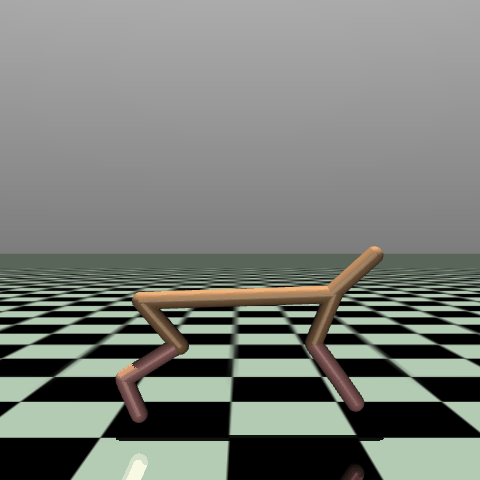
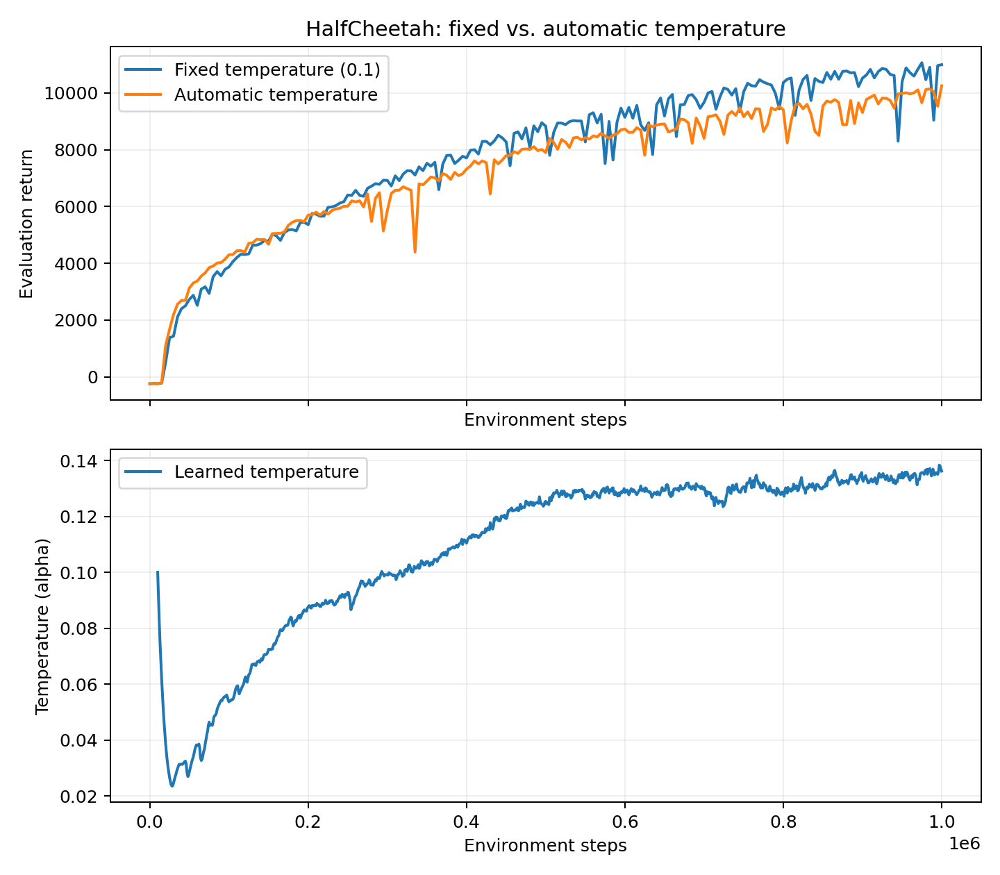
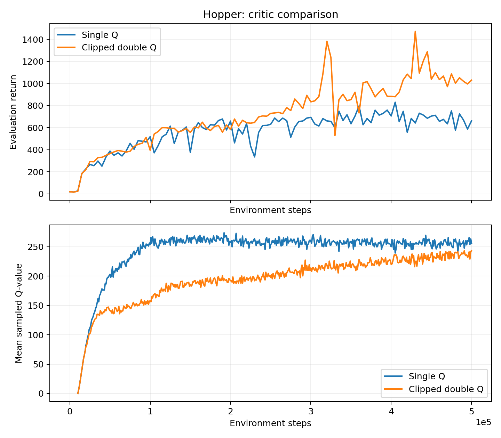
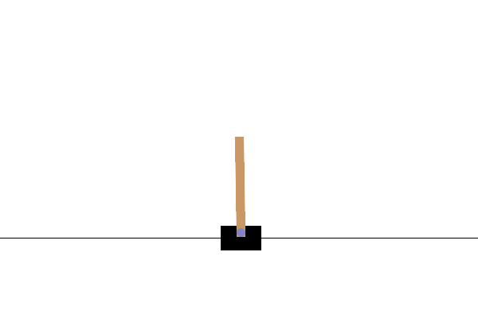
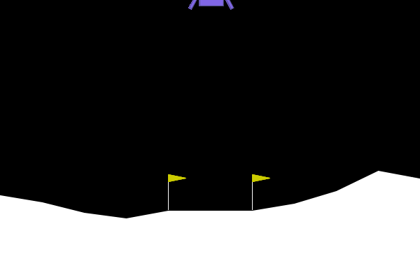
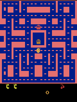
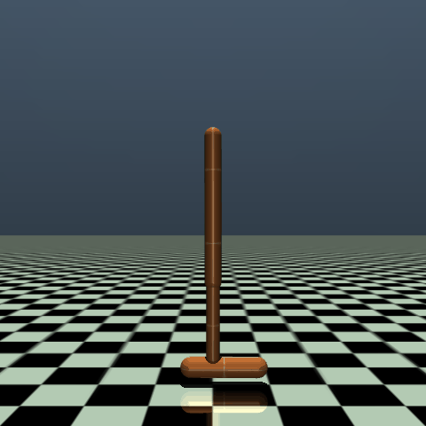
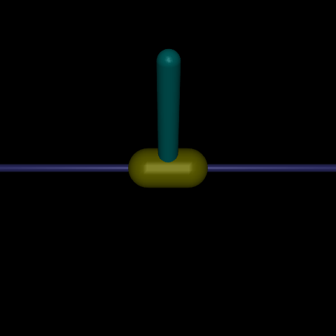

# Deep RL Control Benchmarks

DQN and Soft Actor-Critic implementations evaluated on Atari, LunarLander, and MuJoCo control tasks. This project completes the Berkeley CS185/285 Spring 2026 HW3 starter and studies how target updates, entropy temperature, and critic ensembles affect learning.



Best-checkpoint visualization; quantitative results below use separate evaluation episodes.

## Results

All numbers below are means over 10 evaluation episodes from seed 1. Best means are selected across evaluation checkpoints; final means expose late-training regressions. These are single-seed experiments, not claims of statistical significance.

| Environment | Method | Best mean return | Final mean return |
| --- | --- | ---: | ---: |
| CartPole-v1 | DQN | 409.8 | 409.8 |
| LunarLander-v2 | Double DQN | 251.6 | 235.0 |
| MsPacman | Double DQN | 2208.0 | 1169.0 |
| HalfCheetah-v4 | SAC, fixed temperature | 11065.1 | 10996.8 |
| HalfCheetah-v4 | SAC, learned temperature | 10250.2 | 10250.2 |
| Hopper-v4 | SAC, single Q | 830.1 | 661.0 |
| Hopper-v4 | SAC, clipped double Q | 1471.4 | 1029.4 |





The [PDF report](hw3/results/report.pdf) covers all required experiments and their limitations. [Machine-readable results](hw3/results/summary.json) and [training curves](hw3/results/curves) preserve the measurements behind the figures. Additional plots cover [CartPole](hw3/results/cartpole.png), [LunarLander](hw3/results/lunarlander.png), [the target-update sweep](hw3/results/lunarlander_sweep.png), and [MsPacman training versus evaluation](hw3/results/mspacman.png).

## Policy demonstrations

Every trained configuration is shown below using its best checkpoint and visualization seed 10001. These individual rollouts illustrate behavior; evaluation averages are reported separately. Each GIF has a JSON file recording its checkpoint, seed, length, and return.

### Discrete action control

<table>
<tr>
<td width="33%"><strong>DQN · CartPole</strong><br></td>
<td width="33%"><strong>Double DQN · LunarLander</strong><br></td>
<td width="33%"><strong>Double DQN · MsPacman</strong><br></td>
</tr>
</table>

### HalfCheetah: fixed versus learned temperature

<table>
<tr>
<td width="50%"><strong>SAC · Fixed temperature</strong><br></td>
<td width="50%"><strong>SAC · Learned temperature</strong><br></td>
</tr>
</table>

### Hopper: single versus clipped double Q

<table>
<tr>
<td width="50%"><strong>Hopper · Single Q</strong><br></td>
<td width="50%"><strong>Hopper · Clipped double Q</strong><br></td>
</tr>
</table>

<details>
<summary>Sanity checks and target-update sweep — 5 additional GIFs</summary>

<table>
<tr>
<td width="50%"><strong>Pendulum · Fixed temperature</strong><br></td>
<td width="50%"><strong>Pendulum · Learned temperature</strong><br></td>
</tr>
</table>

<table>
<tr>
<td width="33%"><strong>LunarLander · Target period 250</strong><br></td>
<td width="33%"><strong>LunarLander · Target period 500</strong><br></td>
<td width="33%"><strong>LunarLander · Target period 2000</strong><br></td>
</tr>
</table>

</details>

## Implementation

- DQN with epsilon-greedy exploration, replay, hard target updates, and double-DQN action selection.
- SAC with reparameterized tanh-Gaussian actions, entropy-augmented Bellman targets, and Polyak target updates.
- Learned temperature using a positive log parameterization and a separate optimizer.
- Single-critic and clipped double-critic backups, with numerical tests for gradient flow and update semantics.
- Reproducible Slurm CPU/GPU jobs, explicit environment seeds, local logging, source-revision metadata, and best/final checkpoints.

The [DQN agent](hw3/src/agents/dqn_agent.py) and [SAC agent](hw3/src/agents/sac_agent.py) contain the algorithm updates. Training entry points are in [scripts](hw3/src/scripts); [YAML configurations](hw3/experiments) specify the experiments. Experiments evaluate model-free agents in simulated control benchmarks.

## Run locally

Requires Python 3.10 and SWIG for Box2D. On Debian/Ubuntu, install SWIG with `sudo apt-get install swig`, or use `uv tool install swig` in a user environment.

```bash
cd hw3
uv sync --group report
uv run python -m unittest discover -s tests -v
uv run src/scripts/run_dqn.py -cfg experiments/dqn/cartpole.yaml --eval_interval 2500
MUJOCO_GL=disable uv run src/scripts/run_sac.py -cfg experiments/sac/sanity_invertedpendulum.yaml
```

Training defaults to local logging with W&B disabled. Use `--wandb_mode offline` or `--wandb_mode online` to opt in. `--seed`, `--num_threads`, and `--total_steps` are available for reproducible runs and smoke checks. MuJoCo training does not require graphics; checkpoint rendering uses a working EGL or OSMesa installation.

## Run on Slurm

From `hw3/`, with the environment already installed:

```bash
mkdir -p jobs/logs
export HW3_GIT_COMMIT=$(git rev-parse HEAD)
sbatch --array=0-1 jobs/run.sbatch jobs/sanity.json
sbatch --array=0-4 jobs/run.sbatch jobs/cpu.json
sbatch --gres=gpu:1 --mem=32G --array=0-4 jobs/run.sbatch jobs/gpu.json
```

The example script uses the cluster's `short` partition, two CPUs per task, one Torch thread, and a six-hour limit. Adjust partition, account, memory, and time for your cluster. Each GPU array task requests its own GPU. The four LunarLander settings change only the target-copy period: 250, 500, 1000, or 2000 steps.

Optional Discord notifications use `DISCORD_WEBHOOK` from a local `.env` in the repository root. Secrets, virtual environments, raw experiment outputs, checkpoints, and Slurm logs are ignored by Git.

## Rebuild the deliverables

```bash
cd hw3
MUJOCO_GL=egl uv run src/scripts/render_gallery.py
uv run --group report src/scripts/analyze_results.py
uv run --group report src/scripts/build_report.py
uv run src/scripts/package_submission.py
```

These commands require completed experiment logs in `hw3/exp/`. The report and summary record selected run directories. The archive contains `exp/` and `src/` at its root and is checked against the assignment's 100 MB limit. Upload `hw3/submit.zip` and `hw3/results/report.pdf` separately to the assignment's code and report destinations.

## Attribution and scope

Based on [Berkeley Deep RL HW3, Spring 2026](https://github.com/berkeleydeeprlcourse/homework_spring2026/tree/main/hw3). Network, distribution, wrapper, and infrastructure scaffolding originate from that starter. This repository adds the missing algorithm updates, experiment execution, tests, analysis, and deliverables. It is a learning and evaluation project; results should be repeated across seeds before drawing research or deployment conclusions.
