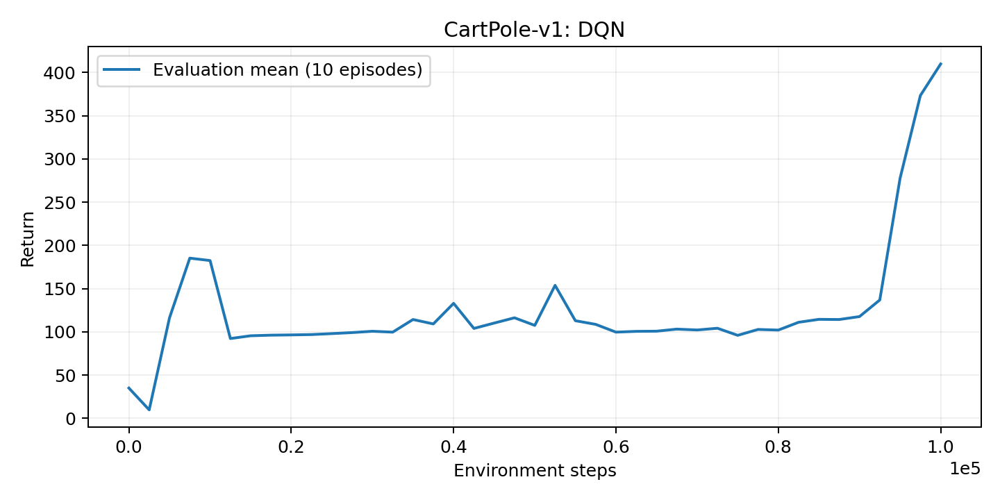
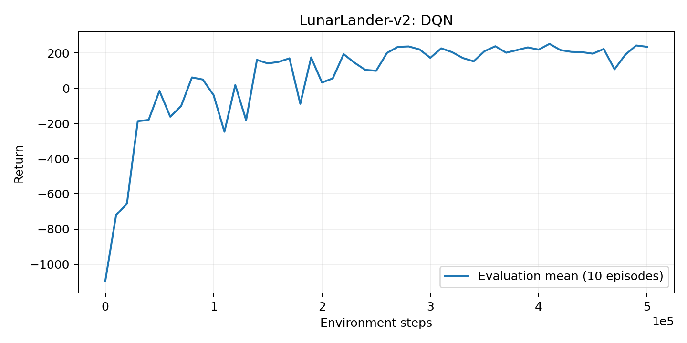
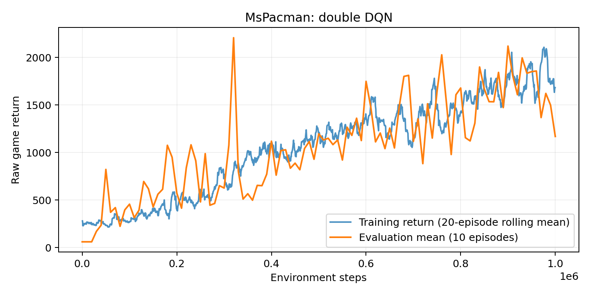
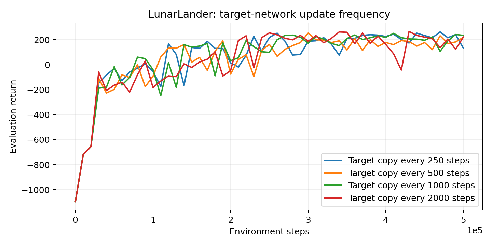
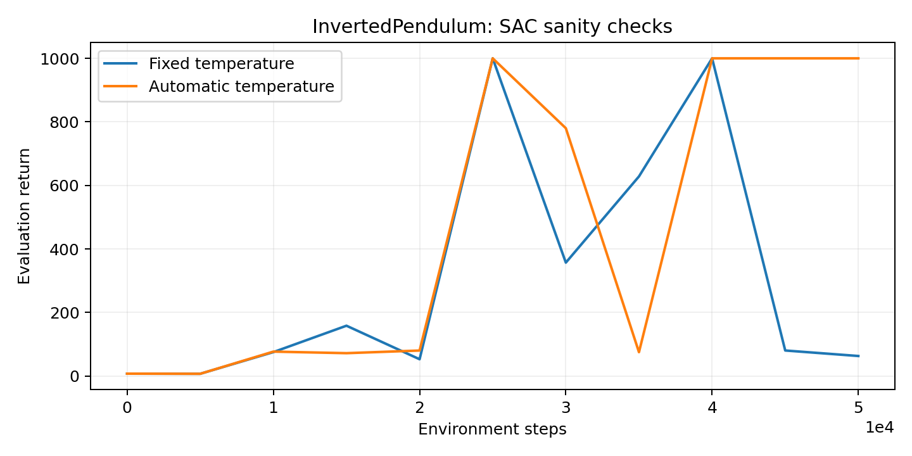
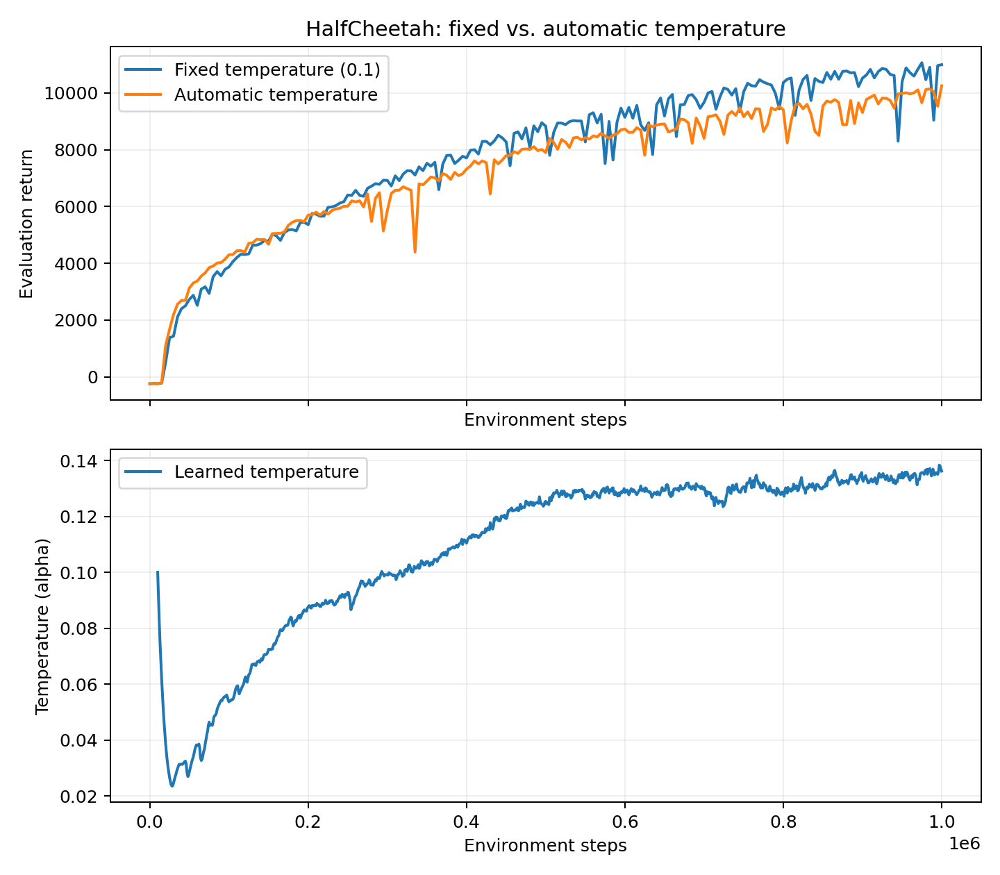
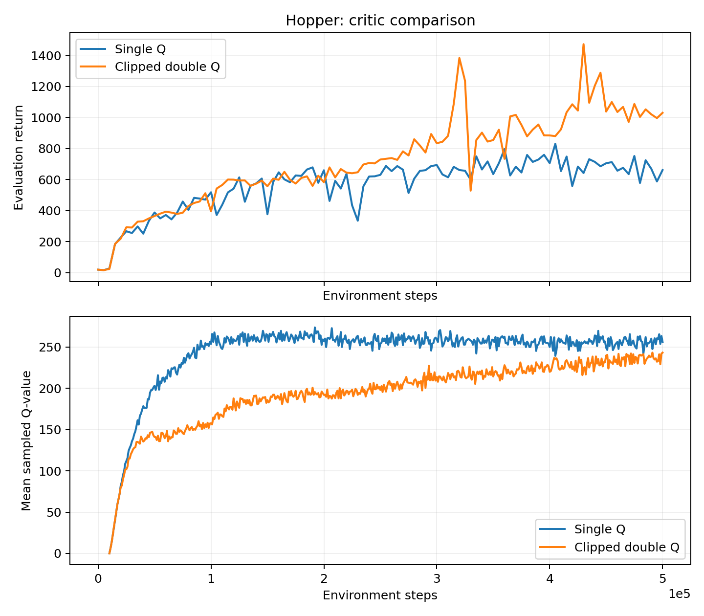

# HW3: Q-Learning and Actor-Critic Algorithms

## Setup and evaluation

Implemented the supplied Berkeley CS185/285 Spring 2026 HW3 starter. DQN uses replay, MSE Bellman regression, epsilon-greedy exploration, gradient clipping when configured, and hard target copies. SAC uses a tanh-transformed Gaussian policy, reparameterized gradients, entropy-augmented targets, Polyak updates, and optional learned temperature and clipped double-Q.

All main comparisons use seed 1 and the supplied training budgets and hyperparameters. Training, evaluation, and rendering environments receive distinct deterministic seeds. Evaluation means use 10 episodes. SAC evaluation samples the policy, matching the starter evaluation interface. Curves are raw evaluation means; the Atari training curve alone uses a trailing 20-episode mean.

Best means are maxima across evaluation checkpoints, not final performance or averages across seeds. Episode standard deviations describe episodes within one evaluation, not uncertainty across training seeds. Results are one-seed assignment experiments; they cannot establish statistical significance. The earlier unseeded-environment CartPole development run is excluded from the final comparisons.

## 2.4 Basic DQN: CartPole

CartPole-v1: best evaluation mean 409.8, final mean 409.8 (episode standard deviation 101.9). The highest individual evaluation episode returned 500, against the assignment target of 500.

The critic predicts one value per discrete action. Its target is r + gamma * (1 - terminal) * max_a Q_target(s_next, a). Gradients apply only to the online prediction for the recorded action. Time-limit truncations retain the bootstrap term. A separate target network prevents the supervised target from changing on every optimizer step.

*Evaluation mean over 10 episodes versus environment steps; basic DQN.*

## 2.5 Double DQN: LunarLander and MsPacman

LunarLander-v2: best evaluation mean 251.6, final mean 235.0 (episode standard deviation 57.7). MsPacman: best evaluation mean 2208.0, final mean 1169.0 (episode standard deviation 180.7).

Double DQN selects the next action with the online network and evaluates it with the target network. This reduces the coupling between selecting a noisy maximum and using that same estimate as a target.

The Atari experiment uses MsPacmanNoFrameskip-v4, as specified by the supplied YAML, with four-frame stacking, 84 x 84 grayscale observations, and action repeat 4. Steps on the plot are agent environment steps after preprocessing, not individual emulator frames.

Training uses the decaying epsilon-greedy policy; evaluation uses epsilon zero. Early exploratory actions often reduce training scores even when the greedy policy has found useful behavior, so the training and evaluation curves need not match. Both curves use raw game rewards: the supplied Atari wrapper records base-environment episode statistics and does not enable reward clipping. Episode sampling and the training-only rolling average also affect the visual difference.

*Double-DQN evaluation mean over 10 episodes; default LunarLander configuration.*

## MsPacman: training and evaluation

*Raw game returns: evaluation mean over 10 episodes and trailing 20-episode training mean. Training includes epsilon-greedy exploration.*

## 2.6 LunarLander hyperparameter sensitivity

Swept hard target-copy periods of 250, 500, 1000 (baseline), and 2000 steps, holding the other configuration values and seed fixed. The parameter controls a useful tradeoff: frequent copies track new estimates quickly, while longer intervals give more stable but older bootstrap targets.

Observed best/final evaluation means: 250 steps: 262.8/132.4; 500 steps: 253.2/219.3; 1000 steps: 251.6/235.0; 2000 steps: 266.3/221.8. The highest final mean in this sweep used a period of 1000 steps.

These are four settings of one parameter rather than a multi-parameter search. A single seed can produce different conclusions from a repeated-seed study, and equal seeds do not make the changing data distributions identical.

*Target-copy frequency was chosen because it controls the speed/stability tradeoff of bootstrap targets. Four periods are compared with all other configuration values fixed.*

## 3.2-3.4 SAC implementation and sanity checks

InvertedPendulum fixed temperature: best evaluation mean 1000.0, final mean 63.1 (episode standard deviation 2.8). Automatic temperature: best evaluation mean 1000.0, final mean 1000.0 (episode standard deviation 0.0).

The actor uses rsample() so the Q objective differentiates through sampled actions. TanhTransform includes the density correction, and Independent sums log probability across action dimensions. Entropy is estimated with negative sampled log probability. Critic weights are frozen during actor optimization while action gradients remain enabled. Target calculations run without gradients.

With entropy enabled, the critic target is r + gamma * (1 - terminal) * [Q_target(s_next, a_next) - alpha * log pi(a_next | s_next)]. The actor minimizes mean(alpha * log pi(a | s) - Q(s, a)). The ensemble actor objective averages current critics; the clipped variant takes a minimum for the target backup.

*Full SAC sanity-check curves with fixed and automatically tuned temperature.*

## 3.4-3.5 HalfCheetah: fixed and learned temperature

Fixed temperature: best evaluation mean 11065.1, final mean 10996.8 (episode standard deviation 93.8). Automatic temperature: best evaluation mean 10250.2, final mean 10250.2 (episode standard deviation 69.9).

Automatic tuning produced a lower final evaluation mean in this run. Its final mean differs from the fixed run by -746.6; its best mean differs by -814.9. This comparison describes the observed run, not a statistically established improvement.

Temperature first fell to 0.0235 near step 28000, then recovered. Overall it increased from the first logged value 0.1000 to 0.1362. The implementation learns log(alpha), starts alpha at 0.1, and uses target entropy -6 for HalfCheetah's six actions. Its loss is -mean(log(alpha) * stop_gradient(log pi + target_entropy)).

Across the final 10% of logged updates, temperature ranged from 0.1313 to 0.1383; temperature was nearly stable within a 10% relative range near the end.

Initial logged entropy was 3.79, compared with target -6; final logged entropy was -6.21. Early diffuse actions exceed the target entropy, so the dual update reduces temperature. As reward learning concentrates the policy around useful locomotion actions, entropy can fall below the constraint and temperature increases to counter further loss of exploration. This explains the observed dip and recovery; temperature responds to the entropy residual, not return directly. A fixed value of 0.1 is already tuned in the starter, so automatic tuning need not outperform it.

The optional fixed-temperature sweep was not run; the required fixed-versus-automatic comparison is shown below.

*Top: fixed versus automatic temperature evaluation means. Bottom: learned temperature from the automatic run.*

## 3.6 Hopper: single Q and clipped double Q

Single Q: best evaluation mean 830.1, final mean 661.0 (episode standard deviation 73.4). Clipped double Q: best evaluation mean 1471.4, final mean 1029.4 (episode standard deviation 85.1). The clipped run's highest individual evaluation episode returned 3295.8; the assignment asks for at least 1500 at least once.

Clipped double Q has the higher final mean in this comparison. Clipped double Q changes the final mean by +368.4 and the best mean by +641.3 relative to single Q in these runs.

Final logged mean Q-values were 256.1 for single Q and 243.2 for clipped double Q. Peak logged means were 273.7 and 243.2, respectively. These measured scales should be read together with the return curves below.

Single Q assigns larger values despite producing lower final returns. This ordering is consistent with optimistic value estimates, while clipped targets provide a more conservative estimate.

Taking the smaller of two target critics counters optimistic errors that can compound under bootstrapping. The lower panel plots the mean current Q-value on sampled replay batches. Comparing Q-values with learning stability helps diagnose overestimation, but these values are not a direct measurement of bias: they include entropy-related value, depend on the state distribution, and are not paired with ground-truth returns from identical state-action pairs.

*Top: evaluation means for single and clipped double Q. Bottom: logged mean current Q-values on replay batches; these are diagnostics, not direct estimates of bias.*

## Validation and reproducibility

Numerical unit tests check Bellman targets, terminal masking, action indexing, double-DQN selection/evaluation, detached targets, target-copy timing, actor gradient flow, critic isolation, temperature-update direction, differentiable bounded-policy entropy, and Polyak interpolation.

Each selected run contains agent.pt, flags.json, log.csv, log.pkl, experiment.json, and a separate best_agent.pt for visualizations. The submitted agent.pt is the final checkpoint; plots include every logged evaluation rather than only the best checkpoint. experiment.json records configuration, arguments, source revision, device, and Torch version. Raw logs and checkpoints remain local; compact curves and summaries are versioned.

Reproduction commands and resource requests are in the README and jobs/ manifests. The submission builder validates complete runs, required files, archive root layout, and the 100 MB size cap. No external tracking account is required. Discord notifications read a local ignored environment file.
