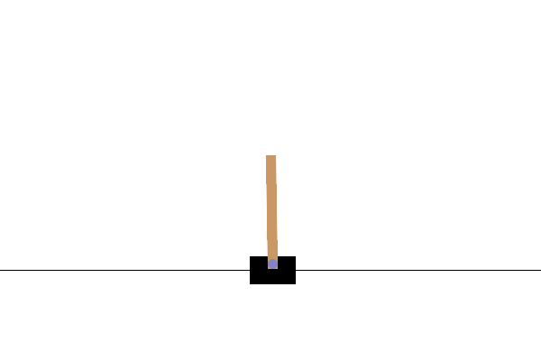
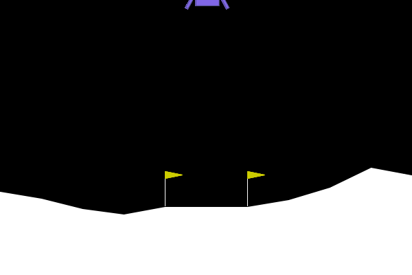
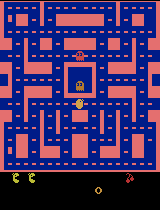
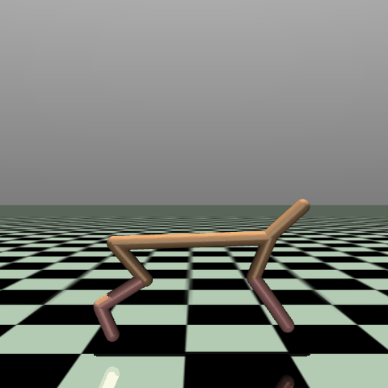
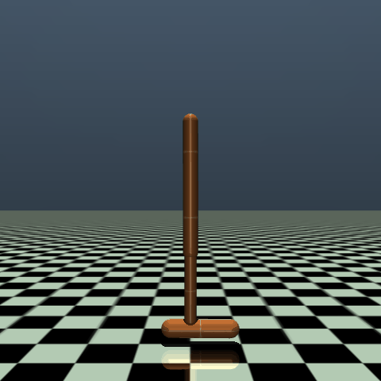
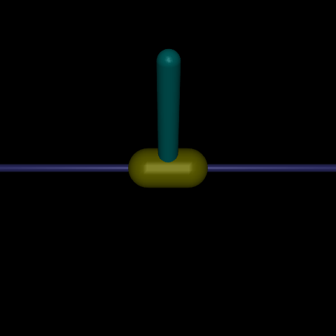

## Policy demonstrations

Every trained configuration is shown below using its best checkpoint and visualization seed 10001. These individual rollouts illustrate behavior; evaluation averages are reported separately. Each GIF has a JSON file recording its checkpoint, seed, length, and return.

### Discrete action control

<table>
<tr>
<td width="33%"><strong>DQN · CartPole</strong> </td>
<td width="33%"><strong>Double DQN · LunarLander</strong> </td>
<td width="33%"><strong>Double DQN · MsPacman</strong> </td>
</tr>
</table>

### HalfCheetah: fixed versus learned temperature

<table>
<tr>
<td width="50%"><strong>SAC · Fixed temperature</strong> </td>
<td width="50%"><strong>SAC · Learned temperature</strong> </td>
</tr>
</table>

### Hopper: single versus clipped double Q

<table>
<tr>
<td width="50%"><strong>Hopper · Single Q</strong> </td>
<td width="50%"><strong>Hopper · Clipped double Q</strong> </td>
</tr>
</table>

Sanity checks and target-update sweep — 5 additional GIFs

<table>
<tr>
<td width="50%"><strong>Pendulum · Fixed temperature</strong> </td>
<td width="50%"><strong>Pendulum · Learned temperature</strong> </td>
</tr>
</table>

<table>
<tr>
<td width="33%"><strong>LunarLander · Target period 250</strong> </td>
<td width="33%"><strong>LunarLander · Target period 500</strong> </td>
<td width="33%"><strong>LunarLander · Target period 2000</strong> </td>
</tr>
</table>

