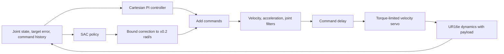

# Residual SAC for UR16e Reaching and Tracking

Simulation-only extension to the DQN/SAC benchmarks. The question is whether a bounded learned correction improves control under unknown payload and command delay, and how many training interactions it needs compared with learning the outer controller with SAC alone.

The arm geometry, kinematics, and inertial parameters come from the UR16e model in [the existing pick-and-place project](https://github.com/Shakthi-Bala/ur16e_bt_pick_place), converted from the official Universal Robots description. The six arm joints are retained; the gripper is replaced by a physical payload body. Mesh licensing and model changes are recorded under `models/`. Contacts are disabled: this is a free-space position-control benchmark, not collision avoidance, assembly, or a hardware validation.

## Controllers

- **Conventional:** damped-Jacobian Cartesian PI control with reference-velocity feedforward and a posture term. Gains and nominal payload compensation are selected on calibration targets, then frozen.
- **Standalone SAC:** predicts the entire outer-loop joint velocity command.
- **Residual SAC:** adds a correction bounded to ±0.2 rad/s per joint to the frozen conventional command.

All methods share the same low-level velocity servo, nominal gravity compensation, joint envelope, 0.7 rad/s velocity limit, and command acceleration filter. The residual is bounded before the combined command is filtered. Nonfinite policy actions fall back to the conventional controller. No robot connection or ROS2 node is included.

## Experimental protocol

Control runs at 50 Hz, with 2 ms MuJoCo dynamics steps. Each episode lasts up to five seconds. Reaching targets are sampled from the robot's forward kinematics around a fixed working posture. Tracking episodes begin with a one-second approach, then follow a smooth, slow 3D reference.

Both learned methods use the same observations: joint angles, velocities, Cartesian error, TCP/reference positions, reference velocity, integrated error, and nine recent commands. Payload and delay are hidden. The observation history does not guarantee that the underlying partially observed dynamics are fully identifiable.

Training randomizes payload between 0 and 3 kg and command delay between 0 and 100 ms. The curriculum starts with reaching and then mixes reaching and tracking. Three training seeds per method use equal 100,000-interaction budgets. Validation does not update replay or the agent; its interaction count is recorded separately.

Calibration, checkpoint validation, and held-out test targets use disjoint seeds. Held-out scenarios cover nominal dynamics, delay only, payload only, their combination, 5 kg payload, and 160 ms delay. Those last two are outside the training randomization ranges. Every method is tested on the same initial states and reference trajectories.

Success means maintaining less than 2 cm error over the last 0.5 seconds of a reach, or spending at least 90% of the post-approach tracking period within 2 cm. Failures count as unsuccessful. Learning-curve qualification requires validation RMSE ≤1 cm and success ≥80% at two consecutive evaluations. Missing crossings remain censored rather than being reported as success at the training budget. A second criterion, frozen before SAC training, requires a 10% RMSE reduction relative to the tuned baseline without lower validation success. This separates learned improvement from inherited baseline competence. Conventional tuning interactions are reported separately; inherited baseline performance is distinguished from improvement learned by the residual.

## Run

Use the environment installed for `benchmark-suite/`; no additional runtime packages are required. From the repository root:

```bash
MUJOCO_GL=disable benchmark-suite/.venv/bin/python -m unittest discover -s residual-control/tests -v
sbatch residual-control/jobs/run.sbatch residual_control.tune
```

After calibration finishes, `results/controller_tuning.json` freezes the selected controller. Training jobs use `configs/experiment.yaml`. Rendering is a separate EGL process; training does not need graphics.

## References

The control decomposition follows [Johannink et al., Residual Reinforcement Learning for Robot Control](https://residualrl.github.io/). The SAC implementation builds on this repository's completed actor-critic implementation. [The BAIR real-robot SAC discussion](https://bair.berkeley.edu/blog/2018/12/14/sac/) motivates measuring sample use, command smoothness, and latency; this extension makes no real-robot claims.

## Reproduce the full study

From the repository root, after the frozen calibration files are present:

```bash
export PROJECT_REVISION=$(git rev-parse HEAD)
for method in standalone residual; do
  for seed in 1 2 3; do
    sbatch --job-name="$method-$seed" residual-control/jobs/run.sbatch \
      residual_control.train --method "$method" --seed "$seed"
  done
done
```

Each run refuses to overwrite a completed result. To repeat the study, move `residual-control/runs/main/` to a separate archive first. Once all six runs complete:

```bash
MUJOCO_GL=disable benchmark-suite/.venv/bin/python -m residual_control.evaluate --method controller
for method in standalone residual; do
  for seed in 1 2 3; do
    MUJOCO_GL=disable benchmark-suite/.venv/bin/python -m residual_control.evaluate \
      --method "$method" --seed "$seed"
  done
done
MUJOCO_GL=disable benchmark-suite/.venv/bin/python -m residual_control.report
MUJOCO_GL=egl benchmark-suite/.venv/bin/python -m residual_control.render
```

Training and evaluation use CPU jobs because these networks are small and physics dominates. EGL is needed only for rendering. `jobs/render.sbatch` renders without a display. `results/learning/` preserves the configuration, source revision, model hash, checkpoint steps, and validation history for every run; large replay/checkpoint outputs stay in ignored `runs/` directories. Test evaluation uses deterministic policies and never updates their parameters. The controller grid, selected gains, and baseline-relative threshold are committed before main training.

## Control path



Standalone SAC replaces the PI-plus-residual block; it shares the downstream servo and limits. The conventional baseline uses the PI block alone. All targets are generated before controller execution from the scenario seed.
