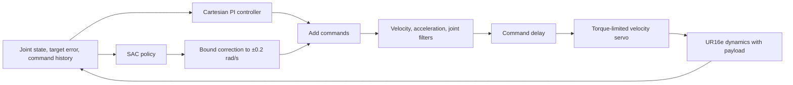
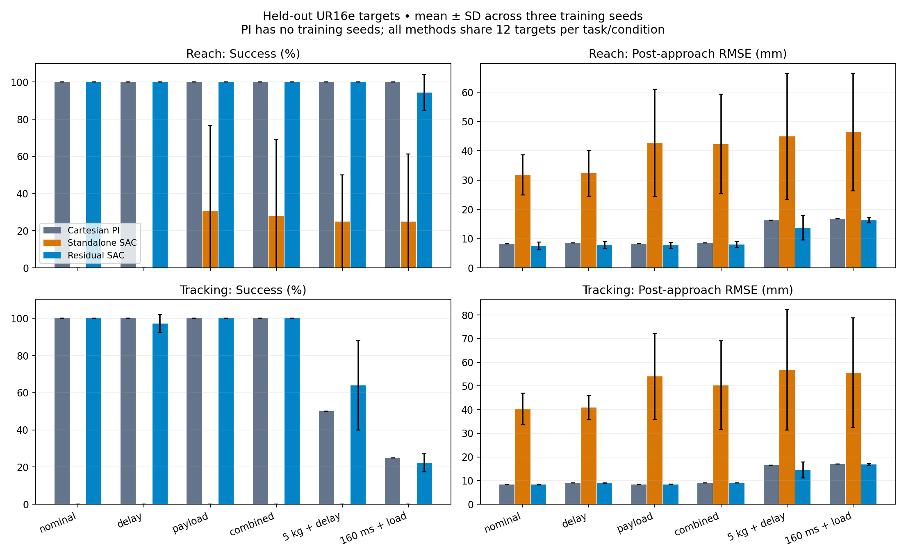
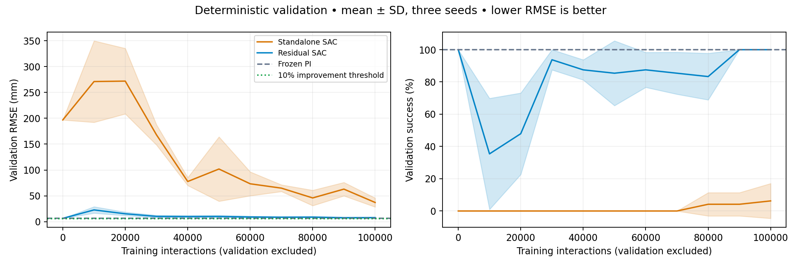
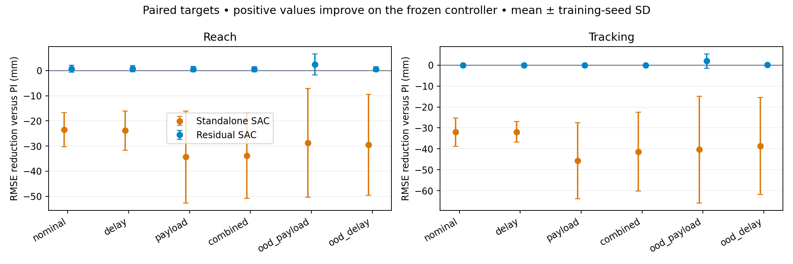

# Residual SAC for UR16e Reaching and Tracking

Simulation-only extension to the DQN/SAC benchmarks. The question is whether a bounded learned correction improves control under unknown payload and command delay, and how many training interactions it needs compared with learning the outer controller with SAC alone.

The arm geometry, kinematics, and inertial parameters come from the UR16e model in [the existing pick-and-place project](https://github.com/Shakthi-Bala/ur16e_bt_pick_place), converted from the official Universal Robots description. The six arm joints are retained; the gripper is replaced by a physical payload body. Mesh licensing and model changes are recorded under `models/`. Contacts are disabled: this is a free-space position-control benchmark, not collision avoidance, assembly, or a hardware validation.

[Concept guide: feedback control, SAC, hidden dynamics, and evaluation](CONCEPTS.md).

The animated comparisons use a light card layout with per-frame position error; amber marks error at or above the 20 mm tolerance. Titles identify the checkpoint, task, payload, delay, and simulation time.

## Controllers

- **Conventional:** damped-Jacobian Cartesian PI control with reference-velocity feedforward and a posture term. Gains and nominal payload compensation are selected on calibration targets, then frozen.
- **Standalone SAC:** predicts the entire outer-loop joint velocity command.
- **Residual SAC:** adds a correction bounded to ±0.2 rad/s per joint to the frozen conventional command.

Joint-envelope clipping takes priority over acceleration filtering near a bound; actual servo dynamics may still cross the envelope and terminate an episode. All methods share the same low-level velocity servo, nominal gravity compensation, joint envelope, 0.7 rad/s velocity limit, and command acceleration filter. The residual is bounded before the combined command is filtered. Nonfinite policy actions fall back to the conventional controller. No robot connection or ROS2 node is included.

## Experimental protocol

Control runs at 50 Hz, with 2 ms MuJoCo dynamics steps. Each episode lasts up to five seconds. Reaching targets are sampled from the robot's forward kinematics around a fixed working posture. Tracking episodes begin with a one-second approach, then follow a smooth, slow 3D reference.

Both learned methods use the same observations: joint angles, velocities, Cartesian error, TCP/reference positions, reference velocity, integrated error, and nine recent commands. Payload and delay are hidden. The observation history does not guarantee that the underlying partially observed dynamics are fully identifiable.

Training randomizes payload between 0 and 3 kg and command delay between 0 and 100 ms. The curriculum starts with reaching and then mixes reaching and tracking. Three training seeds per method use equal 100,000-interaction budgets. Validation does not update replay or the agent; its interaction count is recorded separately.

Calibration, checkpoint validation, and held-out test targets use disjoint seeds. Held-out scenarios cover nominal dynamics, delay only, payload only, their combination, 5 kg payload, and 160 ms delay. Those last two are outside the training randomization ranges. Every method is tested on the same initial states and reference trajectories.

Success means maintaining less than 2 cm error over the last 0.5 seconds of a reach, or spending at least 90% of the post-approach tracking period within 2 cm. Failures count as unsuccessful. Learning-curve qualification requires validation RMSE ≤1 cm and success ≥80% at two consecutive evaluations. Missing crossings remain censored rather than being reported as success at the training budget. A second criterion, frozen before SAC training, requires a 10% RMSE reduction relative to the tuned baseline without lower validation success. This separates learned improvement from inherited baseline competence. Conventional tuning interactions are reported separately; inherited baseline performance is distinguished from improvement learned by the residual.

## Run

Use the environment installed for `benchmark-suite/` (`cd benchmark-suite && uv sync --group report`). The report group includes tabular analysis and PDF dependencies. From the repository root:

```bash
MUJOCO_GL=disable benchmark-suite/.venv/bin/python -m unittest discover -s residual-control/tests -v
sbatch residual-control/jobs/run.sbatch residual_control.tune
```

After calibration finishes, `results/controller_tuning.json` freezes the selected controller and `results/baseline_validation.json` freezes its validation metrics and the improvement threshold. Training jobs use `configs/experiment.yaml`. Rendering is a separate EGL process; training does not need graphics.

## References

The control decomposition follows [Johannink et al., Residual Reinforcement Learning for Robot Control](https://residualrl.github.io/). The SAC implementation builds on this repository's completed actor-critic implementation. [The BAIR real-robot SAC discussion](https://bair.berkeley.edu/blog/2018/12/14/sac/) motivates measuring sample use, command smoothness, and latency; this extension makes no real-robot claims.

## Reproduce the full study

From the repository root, after the frozen calibration files are present:

```bash
export PROJECT_REVISION=$(git rev-parse HEAD)
for method in standalone residual; do
  for seed in 1 2 3; do
    sbatch --job-name="$method-$seed" residual-control/jobs/run.sbatch \
      residual_control.train --method "$method" --seed "$seed"
  done
done
```

Each run refuses to overwrite a completed result. To repeat the study, move `residual-control/runs/main/` to a separate archive first. Once all six runs complete:

```bash
MUJOCO_GL=disable benchmark-suite/.venv/bin/python -m residual_control.evaluate --method controller
for method in standalone residual; do
  for seed in 1 2 3; do
    MUJOCO_GL=disable benchmark-suite/.venv/bin/python -m residual_control.evaluate \
      --method "$method" --seed "$seed"
  done
done
MUJOCO_GL=disable benchmark-suite/.venv/bin/python -m residual_control.report
MUJOCO_GL=egl benchmark-suite/.venv/bin/python -m residual_control.render
```

Training and evaluation use CPU jobs because these networks are small and physics dominates. EGL is needed only for rendering. `jobs/render.sbatch` requests one GPU for headless EGL rendering; the CPU compute nodes used here do not provide EGL libraries. Rendering also works directly on an EGL-capable host. `results/learning/` preserves the configuration, source revision, model hash, checkpoint steps, and validation history for every run; raw training outputs stay in ignored `runs/` directories. Portable selected and final weights are provided in `results/policies/`, so evaluation and rendering also work without those local run folders. Test evaluation uses deterministic policies and never updates their parameters. The controller grid, selected gains, and baseline-relative threshold are committed before main training.

## Control path



Standalone SAC replaces the PI-plus-residual block; it shares the downstream servo and limits. The conventional baseline uses the PI block alone. All targets are generated before controller execution from the scenario seed.

<!-- GENERATED RESULTS -->

## Simulation results

Best checkpoints were selected on validation targets before held-out evaluation. Each learned method has three training seeds; each policy is tested on 144 matched episodes. Values below average conditions and tasks equally; RMSE is the mean of episode RMSE values, rather than a pooled squared-error estimate. ± denotes descriptive training-seed SD, not a confidence interval. The conventional controller is deterministic and has no training-seed variation.

| Method | Success | RMSE after 1 s | Final error | Command acceleration RMS | Failures |
| --- | ---: | ---: | ---: | ---: | ---: |
| Cartesian PI | 89.6% | 11.2 mm | 7.1 mm | 0.7 rad/s² | 0.0% |
| Standalone SAC | 9.0 ± 12.2% | 44.9 ± 14.1 mm | 66.9 ± 39.6 mm | 2.6 ± 0.0 rad/s² | 33.3 ± 23.6% |
| Residual SAC | 89.8 ± 0.4% | 10.6 ± 1.1 mm | 7.9 ± 1.5 mm | 0.9 ± 0.3 rad/s² | 0.0 ± 0.0% |







### Training interactions and checkpoint selection

| Method | Seed | Best validation step | Absolute criterion confirmation step | Baseline improvement confirmation step |
| --- | ---: | ---: | ---: | ---: |
| Standalone SAC | 1 | 100,000 | >100,000 (not reached) | >100,000 (not reached) |
| Standalone SAC | 2 | 100,000 | >100,000 (not reached) | >100,000 (not reached) |
| Standalone SAC | 3 | 100,000 | >100,000 (not reached) | >100,000 (not reached) |
| Residual SAC | 1 | 0 | 100000 | >100,000 (not reached) |
| Residual SAC | 2 | 90,000 | 40000 | >100,000 (not reached) |
| Residual SAC | 3 | 0 | 100000 | >100,000 (not reached) |

### Interpretation and failures

Residual SAC changes aggregate held-out RMSE by +5.8% relative to PI (positive means improvement). 2/3 residual runs select the initial zero-residual checkpoint. A step-zero selection means the controller was retained; it is not evidence that reinforcement learning improved it.

The absolute criterion measures task competence, which residual SAC can inherit before any training. The stricter criterion requires at least 10% lower validation RMSE than the frozen PI controller with no loss of success, at two consecutive checkpoints. Crossings report the second checkpoint, when the pair is confirmed. Validation is sampled every 10,000 interactions, so crossing times have that resolution.

A strong PI controller, local workspace, short episodes, and unnormalized observations can leave little headroom for residual learning. Entropy-driven corrections can also disrupt accurate feedback control. These experiments do not establish superiority across other workspaces, controller gains, training budgets, or reward choices. Checkpoint selection can retain PI even when late training regresses; the learning plots expose those regressions.

The aggregate includes out-of-distribution payload/delay conditions. Inspect `summary.csv` for each condition/task and `worst_residual_cases.csv` for the weakest paired comparisons (ties ordered by error). `unsuccessful_episodes.csv` lists every missed target or terminal failure. If all selected residuals equal PI, paired differences are zero rather than learned gains. RMSE uses samples at and after 1 second; final error is endpoint error. Settling time means first entry into 2 cm followed by staying there, capped at 5 seconds; `settled` records whether the cap is censoring. Command acceleration measures issued commands after filtering, not physical joint acceleration. Early failures use observed samples and are separately counted as unsuccessful.

### Artifacts

- [Per-episode held-out results](results/episodes.csv), [condition summaries](results/summary.csv), and [per-seed aggregates](results/overall_per_seed.csv).
- [Matched target comparisons](results/paired_comparisons.csv), [worst residual cases](results/worst_residual_cases.csv), and [all unsuccessful episodes](results/unsuccessful_episodes.csv).
- [Training interaction thresholds](results/sample_efficiency.json), [validation histories](results/learning_curves.csv), and immutable run metadata in `results/learning/`.
- Portable selected and final model weights in `results/policies/` (NumPy arrays, no pickle); model provenance and mesh license in `models/`; GIF provenance beside every animation.

### Interaction accounting

The controller grid used 144,000 calibration interactions, shared by the conventional and residual methods. A separate 4,000-interaction baseline validation fixed the relative criterion. SAC used 600,000 training interactions across six runs and 228,449 additional validation interactions, excluded from replay. Held-out evaluation used 238,219 interactions. Rendering replays are excluded from these learning counts. Controller calibration cost is not zero and is shared across residual seeds. Any claim about total data efficiency must include that cost; step-zero residual competence alone does not demonstrate cheaper learning.
