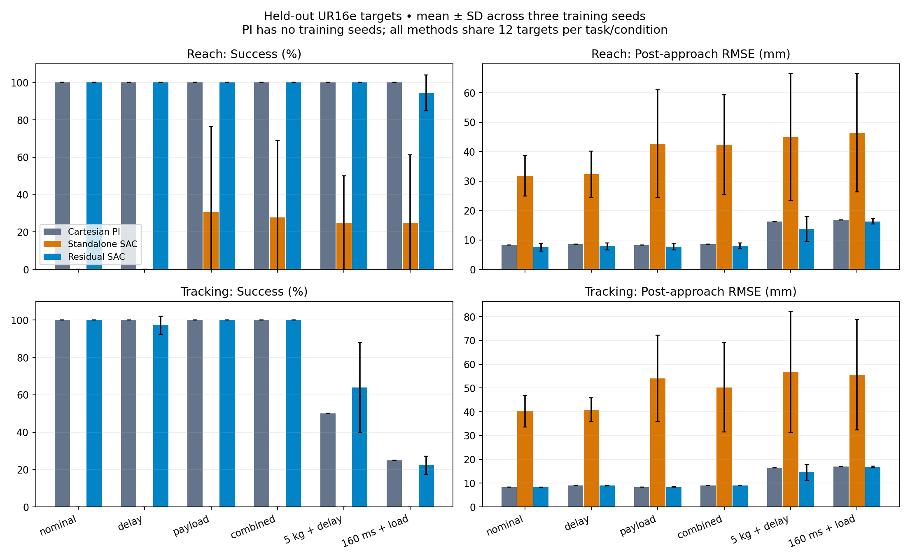
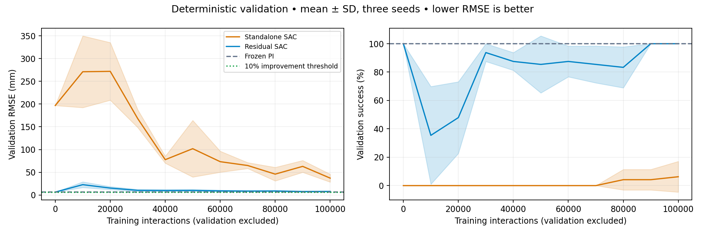
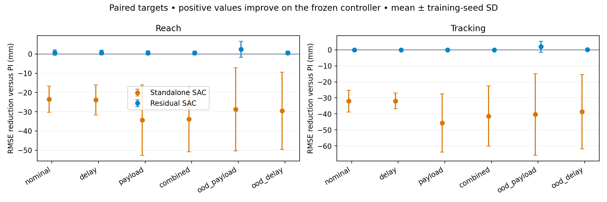

## Simulation results

Best checkpoints were selected on validation targets before held-out evaluation. Each learned method has three training seeds; each policy is tested on 144 matched episodes. Values below average conditions and tasks equally; RMSE is the mean of episode RMSE values, rather than a pooled squared-error estimate. ± denotes descriptive training-seed SD, not a confidence interval. The conventional controller is deterministic and has no training-seed variation.

| Method | Success | RMSE after 1 s | Final error | Command acceleration RMS | Failures |
| --- | ---: | ---: | ---: | ---: | ---: |
| Cartesian PI | 89.6% | 11.2 mm | 7.1 mm | 0.7 rad/s² | 0.0% |
| Standalone SAC | 9.0 ± 12.2% | 44.9 ± 14.1 mm | 66.9 ± 39.6 mm | 2.6 ± 0.0 rad/s² | 33.3 ± 23.6% |
| Residual SAC | 89.8 ± 0.4% | 10.6 ± 1.1 mm | 7.9 ± 1.5 mm | 0.9 ± 0.3 rad/s² | 0.0 ± 0.0% |

### Training interactions and checkpoint selection

| Method | Seed | Best validation step | Absolute criterion confirmation step | Baseline improvement confirmation step |
| --- | ---: | ---: | ---: | ---: |
| Standalone SAC | 1 | 100,000 | >100,000 (not reached) | >100,000 (not reached) |
| Standalone SAC | 2 | 100,000 | >100,000 (not reached) | >100,000 (not reached) |
| Standalone SAC | 3 | 100,000 | >100,000 (not reached) | >100,000 (not reached) |
| Residual SAC | 1 | 0 | 100000 | >100,000 (not reached) |
| Residual SAC | 2 | 90,000 | 40000 | >100,000 (not reached) |
| Residual SAC | 3 | 0 | 100000 | >100,000 (not reached) |

### Interpretation and failures

Residual SAC changes aggregate held-out RMSE by +5.8% relative to PI (positive means improvement). 2/3 residual runs select the initial zero-residual checkpoint. A step-zero selection means the controller was retained; it is not evidence that reinforcement learning improved it.

The absolute criterion measures task competence, which residual SAC can inherit before any training. The stricter criterion requires at least 10% lower validation RMSE than the frozen PI controller with no loss of success, at two consecutive checkpoints. Crossings report the second checkpoint, when the pair is confirmed. Validation is sampled every 10,000 interactions, so crossing times have that resolution.

A strong PI controller, local workspace, short episodes, and unnormalized observations can leave little headroom for residual learning. Entropy-driven corrections can also disrupt accurate feedback control. These experiments do not establish superiority across other workspaces, controller gains, training budgets, or reward choices. Checkpoint selection can retain PI even when late training regresses; the learning plots expose those regressions.

The aggregate includes out-of-distribution payload/delay conditions. Inspect `summary.csv` for each condition/task and `worst_residual_cases.csv` for the weakest paired comparisons (ties ordered by error). `unsuccessful_episodes.csv` lists every missed target or terminal failure. If all selected residuals equal PI, paired differences are zero rather than learned gains. RMSE uses samples at and after 1 second; final error is endpoint error. Settling time means first entry into 2 cm followed by staying there, capped at 5 seconds; `settled` records whether the cap is censoring. Command acceleration measures issued commands after filtering, not physical joint acceleration. Early failures use observed samples and are separately counted as unsuccessful.

### Artifacts

- [Per-episode held-out results](episodes.csv), [condition summaries](summary.csv), and [per-seed aggregates](overall_per_seed.csv).
- [Matched target comparisons](paired_comparisons.csv), [worst residual cases](worst_residual_cases.csv), and [all unsuccessful episodes](unsuccessful_episodes.csv).
- [Training interaction thresholds](sample_efficiency.json), [validation histories](learning_curves.csv), and immutable run metadata in `results/learning/`.
- Portable selected and final model weights in `results/policies/` (NumPy arrays, no pickle); model provenance and mesh license in `models/`; GIF provenance beside every animation.

### Interaction accounting

The controller grid used 144,000 calibration interactions, shared by the conventional and residual methods. A separate 4,000-interaction baseline validation fixed the relative criterion. SAC used 600,000 training interactions across six runs and 228,449 additional validation interactions, excluded from replay. Held-out evaluation used 238,219 interactions. Rendering replays are excluded from these learning counts. Controller calibration cost is not zero and is shared across residual seeds. Any claim about total data efficiency must include that cost; step-zero residual competence alone does not demonstrate cheaper learning.
